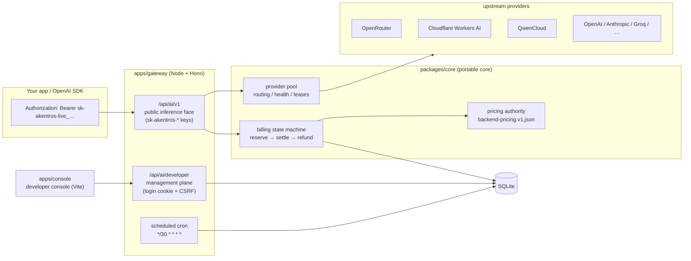

# Akentros Gateway

[](https://github.com/PrimordialSpirit-SANS/akentros/actions/workflows/ci.yml)
[](./LICENSE)
[](https://www.npmjs.com/package/@akentros/core)

**English** | [繁體中文](README.md)

Akentros Gateway is a self-hosted, OpenAI-compatible AI gateway: USD-based billing with integer micro-dollar settlement, multi-provider pooling with automatic failover, `sk-akentros-*` API keys, and a built-in developer console. Core (`packages/core`) is a portable TypeScript library — also published to npm as [`@akentros/core`](https://www.npmjs.com/package/@akentros/core); the gateway runs as a plain Node.js server on SQLite (no external database), on PostgreSQL — from a long-lived VPS to serverless platforms (Neon's WebSocket driver, Cloudflare Hyperdrive) — or on Cloudflare Workers inside a Durable Object; the console is a React + Vite app deployable to Cloudflare Pages. A Docker/compose topology (`docker compose up -d --build`) is documented in [docs/DEPLOYMENT.md](docs/DEPLOYMENT.md) as Topology D.

```bash
cp apps/gateway/.dev.vars.example apps/gateway/.dev.vars   # fill in secrets
npm install
npm run migrate                 # schema + admin account
npm run dev:gateway             # http://localhost:8787
npm run dev:console             # http://localhost:5173
```

See [Quick start](#quick-start) below, [docs/DEPLOYMENT.md](docs/DEPLOYMENT.md) for production, and [docs/openapi.yaml](docs/openapi.yaml) for the full API contract. MIT licensed.

---

The system consists of three parts, all TypeScript:

| Directory | Purpose |
| --- | --- |
| `packages/core` | Portable behavior core: pricing authority, USD billing (reserve/settle/refund, integer micro-dollars), API keys (HMAC + pepper), provider pool routing, SSE parsing, versioned schema migrations. Published to npm. |
| `apps/gateway` | The gateway (Hono): a Node server (`@hono/node-server` + `node:sqlite`) or Cloudflare Workers (single Durable Object + `storage.sql`). Exposes the OpenAI-compatible API, the developer management plane, a built-in account system, and scheduled reconciliation. |
| `apps/console` | Developer console (React + Vite): key management, streaming playground, model catalog, usage logs — with an offline demo mode. |

## Features

- **OpenAI-compatible API**: `GET /api/ai/v1/models`, `POST /api/ai/v1/chat/completions` (SSE streaming, `Idempotency-Key`), `POST /api/ai/v1/embeddings` (text vectors, input tokens only), `POST /api/ai/v1/responses` (a bridged subset of the new SDK default surface — see the compatibility matrix). Point any OpenAI SDK at the `baseURL` and it works. **Idempotency semantics**: OpenAI replays the original response for a completed idempotency key; Akentros by default does not persist prompt/completions and returns `409 idempotent_request_replayed` (with the original `X-Request-Id`). OpenAI-style replay is opt-in per key (`idempotency_replay_ttl_seconds`, up to 7 days): successful responses (JSON and SSE) are persisted for the TTL and replayed byte-for-byte (`X-Akentros-Idempotent-Replay: true`) without re-execution or double billing; in-progress keys return `409 idempotent_request_in_progress`, same-key-different-body returns `409 idempotent_request_conflict` (see `docs/openapi.yaml`).
- **USD billing**: internally settled in integer micro-dollars (no floating-point drift). Every request reserves a spending cap up front, settles on actual usage, and refunds the difference automatically; the whole flow is idempotent, replayable, and reconcilable. Over-reported upstream usage is clamped at the reservation — never overcharged.
- **Multi-provider pool**: 37 credential slots (openrouter, cloudflare-workers-ai, qwencloud, openai, anthropic, groq, …) with weighted rotation, health cooldown, in-flight leases, and automatic failover. Secrets exist only as environment variable names — the database stores opaque credential IDs.
- **Serverless PostgreSQL**: point `DATABASE_URL` at PG and the driver auto-selects — TCP `pg` pooling (Node VPS, Render, Vercel/Netlify functions; automatic TLS to remote hosts) or the Neon-compatible WebSocket driver (`*.neon.tech` auto-detected; edge runtimes and Workers direct; self-hosted `AKENTROS_PG_WS_PROXY` gateways supported). Workers can also go through a Hyperdrive binding. Both drivers share the same interactive-transaction semantics (`FOR UPDATE` row locks, `pg_advisory_xact_lock`), so billing invariants hold regardless of topology. See Topology C in [docs/DEPLOYMENT.md](docs/DEPLOYMENT.md).
- **API key management**: `sk-akentros-live_/sk-akentros-test_` keys, shown exactly once, stored as pepper-HMAC digests; per-key expiry, model allowlists, RPM, max concurrency, and USD spending caps. Key-level RPM/concurrency is enforced by atomic in-database counters; login and key-management rate limiting uses SQLite fixed windows (single-process global) with an in-memory fallback when the database is unavailable.
- **Built-in accounts**: signup/login (JWT cookie + double-submit CSRF, Origin/Referer checks on pre-auth endpoints), admin seed at migrate time, signup bonus, public registration toggle, anti-enumeration by default.
- **Developer console**: overview, keys, streaming playground (token-by-token rendering, usage stats), model catalog (free tiers included), request logs with per-request detail; `?demo=1` offline demo mode.
- **Ops probes and structured logs**: `GET /healthz` reports process and database status (200 ok / 503 degraded) for load balancers and monitoring; the Node topology additionally serves `GET /metrics` (Prometheus text format: request counts, latency, token usage, spend; disable with `AKENTROS_METRICS_ENABLED=false`). Internal logs are single-line JSON, ready for Cloudflare observability, journald, etc.
- **Contract-test guardrails**: openapi.yaml, the frontend/backend catalogs, routing and security invariants are all pinned by tests — drift fails the build. Biome lint/format and `npm audit` (high and above) are enforced in CI.

### OpenAI endpoint compatibility matrix

Check this table before migrating from LiteLLM / one-api (the authoritative list is the `info.description` of `docs/openapi.yaml`, pinned on both sides by contract tests):

| OpenAI endpoint | Supported | Notes |
| --- | :---: | --- |
| `GET /v1/models` | ✅ | |
| `POST /v1/chat/completions` | ✅ | SSE streaming, tool calls, `response_format` (`text` passes through; `json_object`/`json_schema` depend on model capability flags) |
| `POST /v1/embeddings` | ✅ | Text input only, input tokens only |
| `POST /v1/responses` | ✅ | Bridged subset: `model`/`input` (incl. vision `input_text`/`input_image`)/`instructions`/`stream`/`max_output_tokens`/`temperature`/`top_p`; billed through the chat pipeline, wrapped back into Responses objects and `response.*` SSE events; `background`, `previous_response_id`, `tools` etc. return `400 unsupported_feature` |
| legacy `POST /v1/completions` | ❌ | Deprecated format, intentionally unsupported |
| `/v1/audio/*` | ❌ | Not a token-billed model class; not planned |
| `/v1/images/*` | ❌ | Not a token-billed model class; not planned |
| `/v1/moderations` | ❌ | |
| `/v1/files`, `/v1/batches` | ❌ | |
| `/v1/realtime` | ❌ | |

Parameter policy: SDK-default calls work as-is; gateway-neutral parameters (`user`, `store`, `metadata`, `service_tier`) are accepted and dropped (not forwarded, no error); semantically relevant ones (`logprobs`, `parallel_tool_calls`) return `400 unsupported_parameter` naming the field; `n>1` returns `400 unsupported_feature` suggesting independent requests. `/v1/responses` accepts `input` as a string or message array (incl. `input_image` parts for vision models).

## Architecture



## Quick start

Requirements: Node ≥ 22.18 (built-in `node:sqlite`, and the test suites run TypeScript directly via `node --test`). No Docker, no external database required.

```bash
# 1. Configure
cp apps/gateway/.dev.vars.example apps/gateway/.dev.vars
#   set AKENTROS_DB_PATH=./akentros.db (or leave the default)
#   generate JWT_SECRET / AKENTROS_API_KEY_PEPPER (openssl rand -hex 32)
#   set ADMIN_EMAIL / ADMIN_PASSWORD (admin seed)
#   add at least one provider key (e.g. OPENROUTER_API_KEY_1)

# 2. Install and initialize the database (schema + account tables + admin)
npm install
npm run migrate

# 3. Start the gateway and the console
npm run dev:gateway    # http://localhost:8787
npm run dev:console    # http://localhost:5173
#   for console development, set in apps/console/.env:
#   VITE_AKENTROS_API_BASE=http://127.0.0.1:8787/api (gateway CORS already allows localhost:5173)
```

Open http://localhost:5173, log in as the admin, create an API key, and test streaming.
No provider keys yet? The console's **`http://localhost:5173/?demo=1`** offline demo mode
exercises every feature (keys, streaming playground, usage) against simulated data.

### Call it with the OpenAI SDK

```ts
import OpenAI from 'openai';

const client = new OpenAI({
  apiKey: 'sk-akentros-live_…',          // created in the console
  baseURL: 'http://localhost:8787/api/ai/v1',
});

const stream = await client.chat.completions.create({
  model: 'akentros/gpt-5.2',  // model catalog: console "Models" page
  messages: [{ role: 'user', content: 'Hello!' }],
  stream: true,
});
```

Runnable examples for Node, Python and cURL live in [`examples/`](examples/); framework integration recipes (LangChain, Vercel AI SDK, OpenWebUI, LobeChat) in [docs/INTEGRATIONS.md](docs/INTEGRATIONS.md).

## Deployment

Three supported gateway topologies (the console is a static site in all of them — Cloudflare Pages or any static host):

**A. Self-hosted server (Node ≥ 22.18)** — the reference topology. Full procedure (migrations, smoke test, reconciliation, backup) in [docs/DEPLOYMENT.md](docs/DEPLOYMENT.md). Summary:

```bash
npm run build        # build the console
npm run migrate
npm run start:gateway
```

Run under systemd/pm2; the database is a single SQLite file, and a backup is a stopped-copy (or `sqlite3 .backup`). **Single instance only** — billing and rate limiting rely on a single database plus in-process serialization.

**B. Cloudflare Workers + Pages** — the whole gateway runs inside a single SQLite-backed Durable Object (cron replaces the in-process reconciliation loop; migrations run automatically before the first request):

```bash
cd apps/gateway
npx wrangler deploy          # secrets via wrangler secret put
# console: build and upload apps/console/dist to Cloudflare Pages
```

**D. Docker / docker compose** — containerized Topology A: gateway (Node runtime, `/data` SQLite volume, `/healthz` healthcheck) plus an nginx console that proxies `/api` with SSE-safe settings:

```bash
cp apps/gateway/.dev.vars.example .env    # fill secrets
docker compose up -d --build              # console on http://localhost:8080
docker compose run --rm akentros-gateway npm run migrate
```

Configuration, secrets and caveats: Topology D in [docs/DEPLOYMENT.md](docs/DEPLOYMENT.md). Released images are published to GHCR on every `v*` tag.

## Configuration

| Environment variable | Required | Purpose |
| --- | --- | --- |
| `AKENTROS_DB_PATH` | recommended | SQLite database file path (default `./akentros.db`, anchored to `apps/gateway/`; relative paths always resolve against that directory) |
| `AKENTROS_HOST` / `HOST` | optional | Bind address for the Node topology (default `127.0.0.1`, loopback only; set `0.0.0.0` or a specific interface explicitly when behind a reverse proxy or in a container) |
| `DATABASE_URL` | optional | When set to `postgres://…`, switches to PostgreSQL (`npm run migrate` switches too). Driver auto-selection: `*.neon.tech` hosts or `AKENTROS_PG_WS_PROXY` use the Neon-compatible WebSocket serverless driver; everything else uses the TCP `pg` pool (Workers deployments can use a Hyperdrive binding instead — Topology B/C in the docs). Rate limiting and schema checks always prefer the installed database adapter, degrading only on connection failure |
| `AKENTROS_PG_DRIVER` | optional | PG driver override: `auto` (default) \| `pg-pool` (TCP `pg`, incl. Hyperdrive) \| `neon` (WebSocket serverless; aliases `neon-ws`/`serverless`). Invalid values fail fast |
| `AKENTROS_PG_SSL` | optional | TLS mode: `disable` \| `require` \| `verify-full`; default `auto` — honors the connection string's `sslmode`, remote hosts get automatic `require` (unverified), localhost/private/Unix sockets stay plaintext |
| `AKENTROS_PG_WS_PROXY` | optional | Self-hosted pg-gateway/supavisor-compatible WebSocket proxy address (static `host[:port][/path]` or a `{host}` template); setting it selects the neon driver |
| `AKENTROS_PG_WS_SECURE` | optional | Whether the WS gateway uses `wss` (default `true`; `false` only when the proxy sits behind a TLS terminator during local development) |
| `AKENTROS_PG_POOL_MAX` | optional | PG pool cap (serverless functions default to 1 per instance; long-lived processes default to 10) |
| `JWT_SECRET` | ✅ | Session cookie signing key (≥ 32 bytes) |
| `AKENTROS_API_KEY_PEPPER` | ✅ | API key HMAC pepper (≥ 32 bytes) |
| `AKENTROS_ENABLED` | recommended | Fail-closed switch; `/api/ai/*` exists only when `true` |
| `ADMIN_EMAIL` / `ADMIN_PASSWORD` | optional | Admin seed at migrate time |
| `AKENTROS_SIGNUP_BONUS_USD` | optional | Signup starting balance (default $5.00) |
| `AKENTROS_ADMIN_STARTING_CREDITS_USD` | optional | Admin starting balance (default $500.00) |
| `AKENTROS_DISABLE_REGISTRATION` | optional | Set `true` to close public signup |
| `AKENTROS_SIGNUP_ANTI_ENUMERATION` | optional | Anti-enumeration (default on): identical 202 acceptance for any email — same status, body, cookies, timing; no session, no user payload. Internal-only deployments may set `false` to restore the explicit 201/409 UX |
| `AKENTROS_TRUST_PROXY` | optional | Trusted reverse proxy declaration: set `true` when a proxy that OVERWRITES identity headers (Cloudflare, nginx) sits in front. Login/signup rate limiting then uses `cf-connecting-ip`, falling back to the LAST `x-forwarded-for` value; pre-auth same-origin checks rebuild the origin from `x-forwarded-proto`/`x-forwarded-host`. Unset Node deployments use the unforgeable socket address only. A degraded identity logs `akentros_auth_rate_limit_identity_degraded`. **Proxy deployments MUST set this and require the proxy to overwrite identity headers** (nginx: `proxy_set_header cf-connecting-ip $remote_addr;`). Cloudflare Workers deployments always trust headers |
| `FRONTEND_ORIGINS` | recommended | Console origins allowed to send cookies (CSV) |
| `OPENROUTER_API_KEY_1` … | optional | Upstream provider keys, see [docs/PROVIDERS.md](docs/PROVIDERS.md) |

The complete list is in `apps/gateway/.dev.vars.example`.

## Documentation

| Document | Contents |
| --- | --- |
| [README.md](README.md) | 繁體中文 main README (authoritative) |
| [docs/openapi.yaml](docs/openapi.yaml) | Full public + management plane contract (OpenAPI 3.1) |
| [docs/PROVIDERS.md](docs/PROVIDERS.md) | Upstream provider API shapes, parameter quirks, price tables, adding a provider |
| [docs/DEPLOYMENT.md](docs/DEPLOYMENT.md) | Deployment runbook: topologies A–D, migrations, smoke test, reconciliation, canary, rollback |
| [docs/INTEGRATIONS.md](docs/INTEGRATIONS.md) | Framework integrations: LangChain (JS/Python), Vercel AI SDK, OpenWebUI, LobeChat |
| [docs/MIGRATION.md](docs/MIGRATION.md) | Migrating from LiteLLM and one-api |
| [docs/RELEASING.md](docs/RELEASING.md) | Release runbook: versioning, tags, npm publish, GHCR images, one-time platform settings |
| [docs/ADR-0001-rebuild-boundaries.md](docs/ADR-0001-rebuild-boundaries.md) | Architecture decision: contract authority, configuration separation, security and billing boundaries |
| [docs/BRAND_ASSETS.md](docs/BRAND_ASSETS.md) | Brand icon policy (third-party trademarks are not redistributed with the repo) |
| [examples/](examples/) | Runnable examples: Node SDK, Python SDK, cURL |

## Community & support

- **Bugs and feature requests**: [issues](https://github.com/PrimordialSpirit-SANS/akentros/issues) (templates provided).
- **Questions and discussion**: GitHub Discussions — the channel `CONTRIBUTING.md` promises; see [docs/RELEASING.md](docs/RELEASING.md) for the one-time enablement step. Until then, questions go through issues.
- **Contributing**: read [CONTRIBUTING.md](CONTRIBUTING.md) (contract-first rules) and the [Code of Conduct](CODE_OF_CONDUCT.md).
- **Support routing**: [SUPPORT.md](SUPPORT.md).

## Security model (summary)

- Key plaintext exists exactly once, at creation/rotation; the database stores prefix/suffix masks and HMAC-SHA256 (pepper) digests.
- Prompts, completions, full keys and provider tokens never persist: not in the database, not in logs, not in error responses (pinned by contract tests).
- Provider secrets live only in runtime environment variables; the database stores opaque credential IDs and health state.
- The billing pipeline is idempotent end to end; a post-crash reconciliation job refunds expired reservations and quarantined requests.

Please report vulnerabilities per [SECURITY.md](SECURITY.md) — not via public issues.

## License

[MIT](LICENSE). Third-party brand names and trademarks belong to their respective owners (see [docs/BRAND_ASSETS.md](docs/BRAND_ASSETS.md)).
